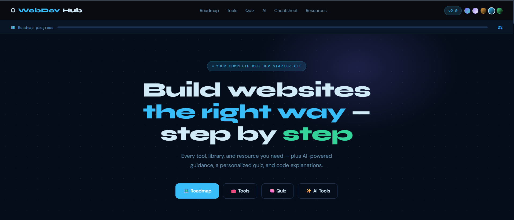
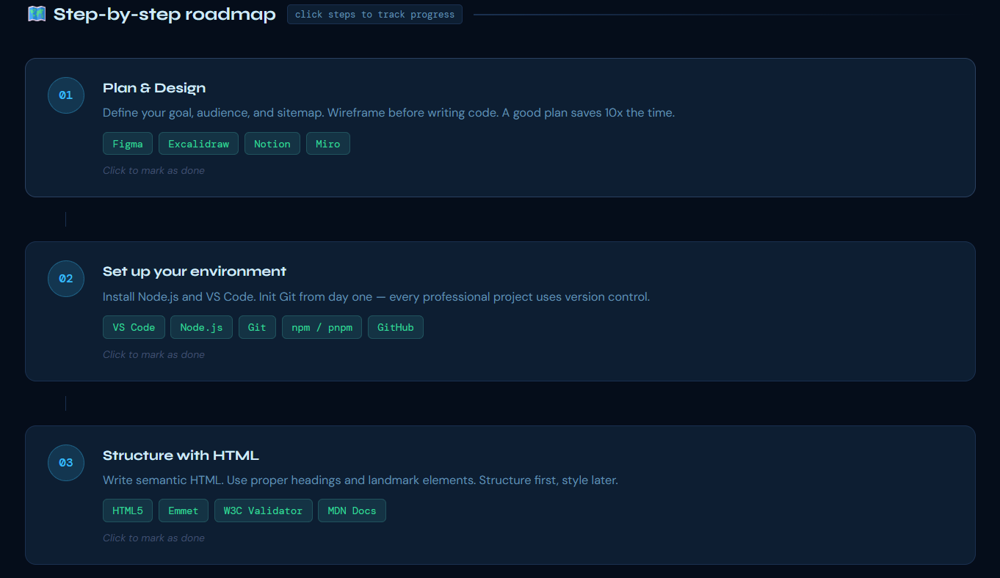
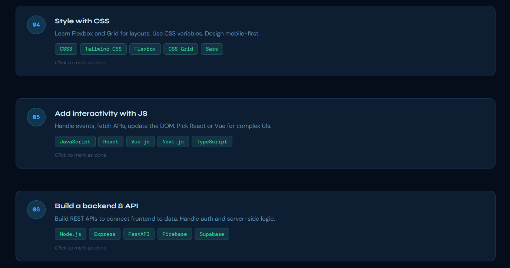
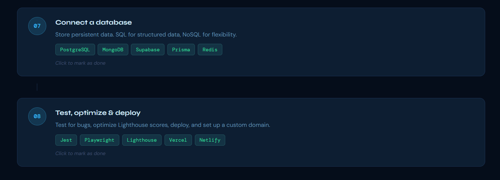
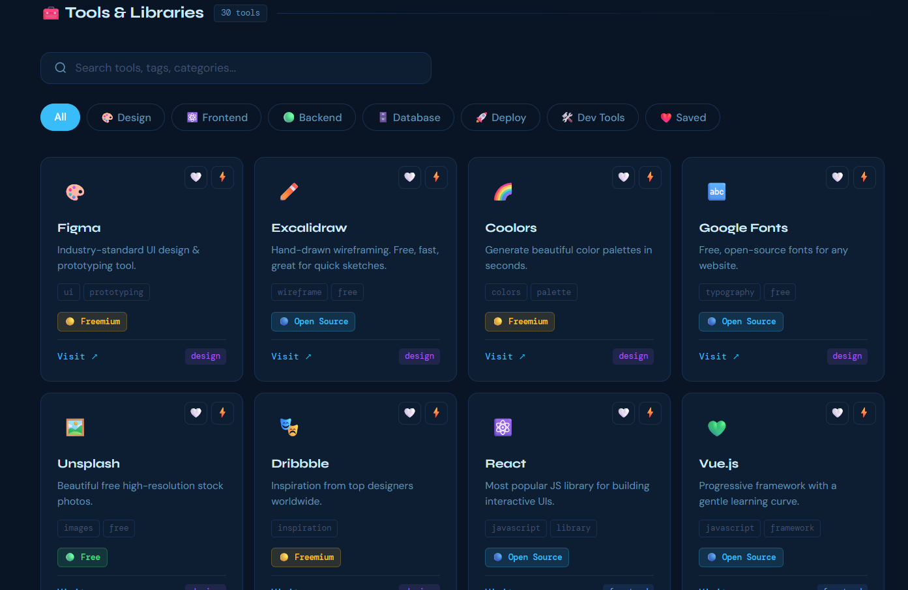
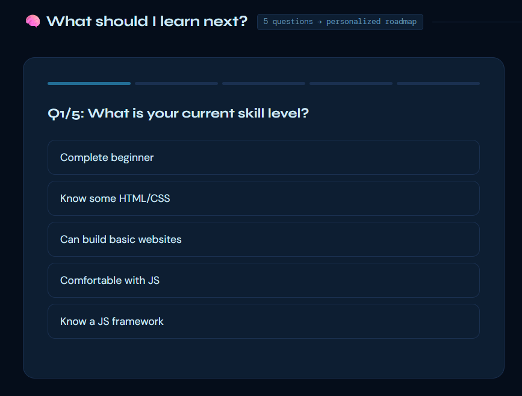
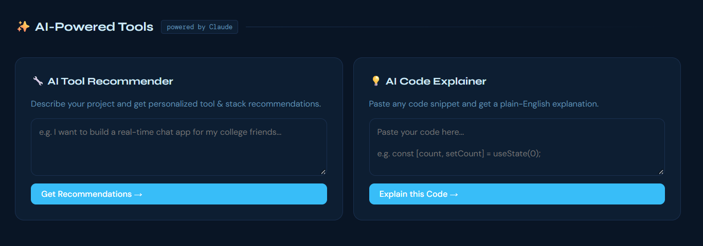
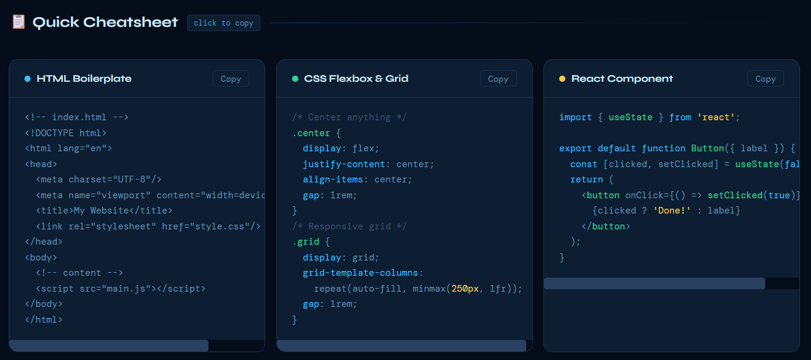

# ⚡ WebDev Hub

**Your complete guide to building websites, from beginner to builder.**

<p align="left">
  
  
  
  
  
</p>

WebDev Hub is a developer-focused learning platform designed to help beginners and aspiring web developers navigate the world of web development. It brings together essential tools, libraries, learning resources, interactive quizzes, and AI-powered assistance in one place.

🌐 **Live Website:** [WebDev Hub](https://webdev-hub-eosin.vercel.app/)

---

## ✨ Features

### 🗺️ Step-by-Step Roadmap
- Structured web development learning path.
- 8 roadmap steps.
- Track learning progress.
- Mark completed learning steps.

### 🧰 Tools & Libraries
- Explore 30+ development tools and libraries.
- Search tools by name, tags, or categories.
- Filter by Design, Frontend, Backend, Database, Deployment, and Dev Tools.
- Save useful tools for later.
- Compare different development tools.

### 🧠 Personalized Learning Quiz
- Interactive 5-question quiz.
- Discover what to learn next.
- Get a personalized learning roadmap.

### ✨ AI-Powered Features
- **AI Tool Recommender:** Get tool and technology stack recommendations based on your project requirements.
- **AI Code Explainer:** Paste code snippets and receive easy-to-understand explanations.
- Powered by Claude.

### 📋 Quick Cheatsheet
- Access commonly used coding references.
- Copy useful code snippets quickly.

### 📚 Learning Resources
- Explore free and paid web development learning resources.

---

## 🛠️ Tech Stack

- **HTML5** – Website structure
- **CSS3** – Styling, responsive layouts, themes and animations
- **Vanilla JavaScript** – Interactive features and application logic
- **Claude API** – AI-powered tool recommendations and code explanations
- **Google Fonts** – Syne, DM Sans and DM Mono
- **Browser localStorage** – Saves user preferences and learning progress
- **Vercel** – Deployment


## 🚀 Getting Started

### Prerequisites
- A modern web browser
- Git (optional)

### Installation

1. Clone the repository:

   git clone https://github.com/aasthas7660/webdev-hub.git

2. Open the project folder.

3. Open `index.html` in your browser.

That's it! WebDev Hub is ready to explore.

## 🌐 Live Demo

[Visit WebDev Hub](https://webdev-hub-eosin.vercel.app/)


## 📸 Screenshots

### 🏠 Homepage


### 🗺️ Step-by-Step Learning Roadmap




### 🧰 Tools & Libraries


### 🧠 Personalized Learning Quiz


### ✨ AI-Powered Features


### 📋 Quick Cheatsheet



## 🛠️ What Makes It Useful?

- Beginner-friendly learning experience.
- Organized development resources.
- Interactive learning tools.
- AI-assisted guidance.
- Progress tracking.
- Easy access to essential developer resources.


## 📁 Project Structure

```text
webdev-hub/
│
├── index.html
├── logo.png
├── robots.txt
├── sitemap.xml
├── vercel.json
├── screenshots/
│   ├── home.png
│   ├── roadmap-01.png
│   ├── roadmap-02.png
│   ├── roadmap-03.png
│   ├── tools-library.png
│   ├── learning-quiz.png
│   ├── ai-features.png
│   └── cheatsheet.png
│
└── README.md
```
## 🔮 Future Improvements

- Complete and improve AI-powered features.
- Add more development tools and learning resources.
- Expand the learning roadmap with more topics.
- Improve the user experience and accessibility.


## 🎯 Project Goal

WebDev Hub was created to make learning web development easier and more organised for beginners.

The goal is to bring learning roadmaps, development tools, coding references, and useful resources together in one place, helping learners move from beginner to builder with confidence.
---

<p align="center">
  Built with ❤️ for developers.
  <br/>
  <b>Learn • Explore • Build</b>
</p>
